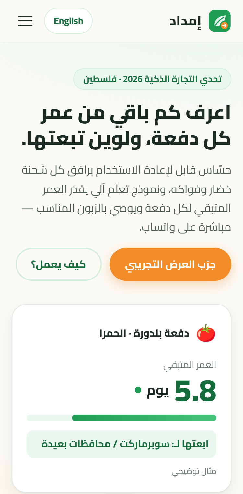
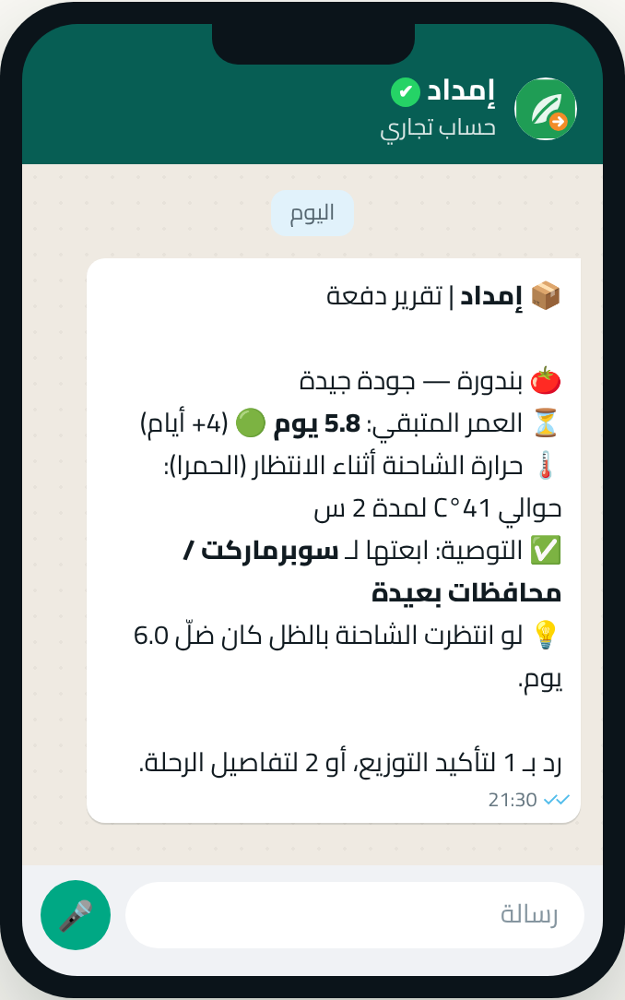

<div dir="rtl">

<p align="center">
  
</p>

<h1 align="center">إمداد · Amdad</h1>

<p align="center">
  <strong>اعرف كم باقي من عمر كل دفعة، ولوين تبعتها.</strong>
</p>

<p align="center">
  <a href="https://rushdija.github.io/amdad/"></a>
  
</p>

<p align="center">
  <a href="https://rushdija.github.io/amdad/"><strong>🌐 العرض المباشر</strong></a> ·
  <a href="README.md">🇬🇧 English</a> ·
  <a href="docs/model.md">📐 النموذج</a> ·
  <a href="docs/roadmap.md">🗺️ خارطة الطريق</a>
</p>

---

إمداد شركة ناشئة مشاركة في **تحدي التجارة الذكية 2026 (فلسطين)**. هذا المستودع هو النموذج الأولي (واجهة أمامية فقط): صفحة تعريفية ثنائية اللغة مع عروض تفاعلية لتقدير العمر المتبقي، وتوزيع الدفعات، وتوصية واتساب.

## المشكلة

موزّعو الخضار والفواكه بالجملة في الضفة الغربية ينقلون البضاعة في **شاحنات غير مبرّدة عبر الحواجز** مثل الحمرا وتياسير. الحرارة والتأخير يتلفان الدفعات بشكل غير مرئي، فتصبح الدفعات التي قُطفت في نفس اليوم **بأعمار متبقية مختلفة**. يرسل الموزّع دون أن يعلم بضاعة قريبة من التلف لزبائن يخزّنونها لأيام، ثم **يدفع ثمن المرتجعات**.

- **MAS (2025):** 14 حاجزًا على الطرق الرئيسية، بمتوسط تأخير 42 دقيقة.
- **PNN (2025):** تاجر من الخليل انتظر من ساعة إلى 4 ساعات على الحواجز، وتلفت بضاعته داخل شاحنات مغلقة.
- **أبحاث جامعة Wageningen:** خسائر البندورة تصل إلى 30–50% في الشاحنات غير المبرّدة.

## الحل

**حسّاس قابل لإعادة الاستخدام يرافق كل شحنة**، و**نموذج تعلّم آلي متخصص** يقدّر العمر المتبقي لكل دفعة و**يوصي بالزبون المناسب**. تصل التوصيات عبر **واتساب**، الأداة التي يستخدمها الموزّعون أصلًا.

مستوحى من Zest Fresh (الولايات المتحدة)، ومُكيّف لواقع فلسطين: الحواجز، الشاحنات غير المبرّدة، والموزّعين الصغار.

## كيف يعمل

1. 📡 **حسّاس يرافق الشحنة**: يسجّل الحرارة والوقت من القطف حتى التسليم، بما في ذلك الانتظار على الحواجز.
2. 🧠 **نموذج تعلّم آلي يقدّر العمر المتبقي**: يحوّل سجل الرحلة إلى عدد الأيام المتبقية لكل دفعة.
3. 💬 **توصية على واتساب**: كم باقي من عمر الدفعة ولوين تبعتها (مطعم، بقالة، سوبرماركت).

## ميزات النموذج الأولي

- 🧮 **حاسبة العمر المتبقي للدفعة**: المنتج، الجودة، ساعات ما قبل التحميل، حرارة الخارج، ساعات القيادة، الحاجز (بقيم افتراضية توضيحية)، شمس/ظل، نوع الشاحنة ← الأيام المتبقية، التصنيف 🔴🟡🟢، الزبون المقترح، رسم بياني SVG للعمر المستهلك في كل مرحلة، ومقارنة "لو انتظرت في الظل".
- 📦 **توزيع الدفعات بخوارزمية FEFO**: دفعات وزبائن قابلون للتعديل؛ كل دفعة تذهب للزبون صاحب أطول مدة تخزين تتحمّلها، مع ملخص للأخطاء التي تم تجنّبها.
- 💬 **معاينة واتساب حيّة**: هاتف يعرض الرسالة الخاصة بدفعة الحاسبة وتتحدّث مباشرة.
- 🌍 **ثنائي اللغة**: العربية (افتراضيًا، من اليمين لليسار) والإنجليزية، مع حفظ اللغة المختارة.
- 📱 **مصمم للهاتف أولًا**، بدون أي مكتبات خارجية.

## النموذج (ملخص)

نموذج حرارة–زمن مبني على **قاعدة Q10** (التلف يتسارع ~2–3 أضعاف لكل +10 درجات):

<div dir="ltr">

```
rate(T)        = Q10 ^ ((T − 20) / 10),   Q10 = 2.5
consumed_days  = hours × rate(T) / 24
remaining_days = base_shelf_life × quality_factor − Σ consumed_days
```

</div>

"حسّاس افتراضي" يقدّر حرارة داخل الشاحنة من حرارة الخارج (مثلًا +9 درجات لشاحنة مغلقة واقفة تحت الشمس على الحاجز). مثال: بندورة بجودة جيدة، 6 ساعات قبل التحميل على 32 درجة، 3 ساعات قيادة، حاجز الحمرا ساعتين تحت الشمس، شاحنة مغلقة ← **5.8 يوم 🟢** (و6.0 يوم لو انتظرت في الظل).

➡️ المعادلات الكاملة والقيم التوضيحية والقيود: **[docs/model.md](docs/model.md)** (بالإنجليزية)

## التقنيات

- HTML5 وCSS3 وJavaScript بدون أطر عمل
- SVG للشعار والأيقونات والرسم البياني (بدون مكتبات)
- خط Cairo من Google Fonts
- استضافة على GitHub Pages؛ بدون خادم، بدون خطوة بناء، بدون واجهات برمجية خارجية

## التشغيل محليًا

انسخ المستودع وافتح `index.html` في المتصفح. هذا كل شيء.

<div dir="ltr">

```bash
git clone https://github.com/RushdiJa/amdad.git
```

</div>

## هيكل المشروع

<div dir="ltr">

```
amdad/
├── index.html
├── css/style.css
├── js/i18n.js            # all Arabic & English text
├── js/model.js           # Q10 shelf-life model
├── js/allocation.js      # FEFO allocation
├── js/app.js             # UI, chart, WhatsApp preview
├── assets/               # logo, favicon, og-image
├── docs/model.md
├── docs/roadmap.md
├── docs/screenshots/
├── README.md / README.ar.md
├── CONTRIBUTING.md
└── LICENSE
```

</div>

## لقطات الشاشة

| الهاتف (عربي) | معاينة واتساب |
|---|---|
|  |  |

## خارطة الطريق

1. **النموذج الأولي** (هذا المستودع): صفحة تعريفية وعروض تفاعلية.
2. **تجربة ميدانية** مع 3–5 موزّعين وحسّاسات حقيقية على طرق فلسطينية.
3. **نموذج تعلّم آلي مدرَّب** على بيانات التجربة، مع فحص جودة بالصور.
4. **بوت واتساب** يرسل التوصيات لكل دفعة تلقائيًا.

التفاصيل: [docs/roadmap.md](docs/roadmap.md)

## الفريق

| الاسم | الدور |
|---|---|
| آرام عودة | البحث |
| إيمان الجلاد | تصميم UI/UX |
| رشدي الجلاد | الاختبار الميداني |
| ميليسا عودة | الأعمال والتسويق |
| وسيم يحيى | تطوير النموذج الأولي |

## ⚠️ تنبيه

تقديرات العرض التجريبي تستخدم **نموذجًا علميًا مبسّطًا وقيمًا توضيحية**، وليست قياسات حقيقية ولا يجب الاعتماد عليها في قرارات تجارية. سيُعايَر المنتج الحقيقي ببيانات حسّاسات من رحلات فلسطينية.

## المساهمة والرخصة

راجع [CONTRIBUTING.md](CONTRIBUTING.md). مرخّص بموجب [رخصة MIT](LICENSE) © 2026 فريق إمداد.

---

<p align="center"><a href="README.md">Read this in English →</a></p>

</div>
