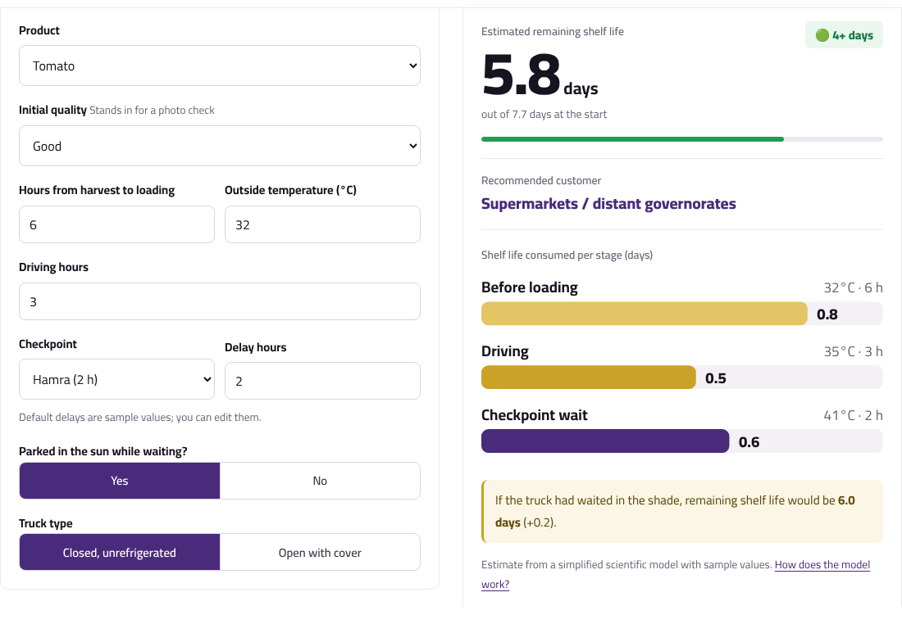
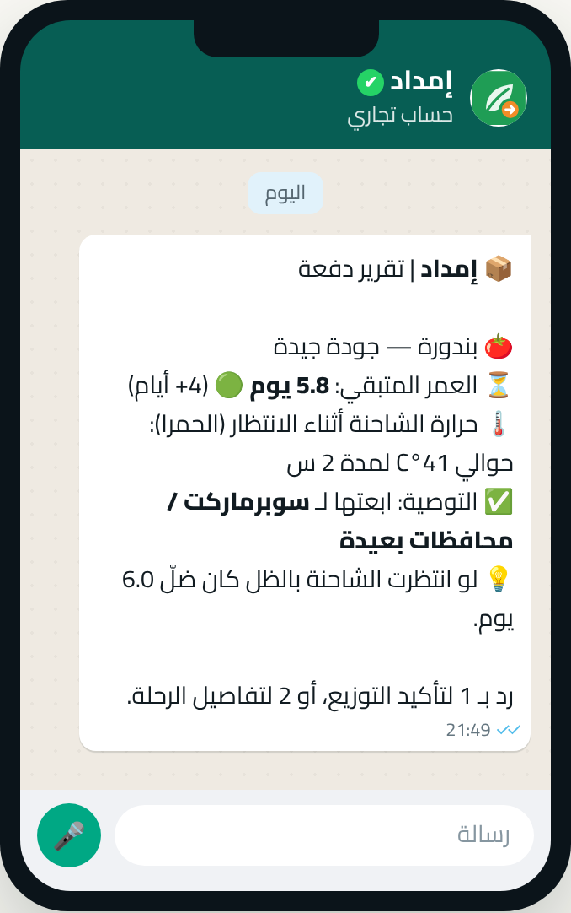

<p align="center">
  
</p>

<h1 align="center">Imdad · إمداد</h1>

<p align="center">
  <strong>Know how much life each batch has left, and where to send it.</strong><br>
  <span dir="rtl">اعرف كم باقي من عمر كل دفعة، ولوين تبعتها.</span>
</p>

<p align="center">
  <a href="https://rushdija.github.io/imdad/"></a>
  
  
</p>

<p align="center">
  <a href="https://rushdija.github.io/imdad/"><strong>🌐 Live demo</strong></a> ·
  <a href="README.ar.md">🇵🇸 اقرأ بالعربية</a> ·
  <a href="docs/model.md">📐 Model</a> ·
  <a href="docs/roadmap.md">🗺️ Roadmap</a>
</p>

---

Imdad is a startup in the **Smart Commerce Challenge 2026 (Palestine)**, challenge area **Logistics & Supply Chain**. This repository is the frontend-only MVP: a bilingual landing page with interactive demos of the shelf-life estimate, the batch allocation and the WhatsApp recommendation.

## The problem

Wholesale produce distributors in the West Bank move fruit and vegetables in **unrefrigerated trucks through checkpoints** such as Hamra and Tayasir. Heat and delays damage batches invisibly, so batches harvested the same day end up with **different remaining shelf life**. Distributors unknowingly send near-spoiled produce to customers who store it for days, and then **pay for the returns**.

> **Problem statement:** Wholesale produce distributors in Palestine need a way to match each batch to the right customer based on its remaining shelf life, because checkpoint delays and heat cause hidden damage that only shows up after delivery.

**Root-cause evidence**

| Source | What it shows |
|---|---|
| PNN news report, Jul 2025 (interview with Hebron vegetable merchant Shadwan Abu Sneineh) | Waits of 1–4 hours at checkpoints, including Hamra. Produce quality is ruined, and some loads spoil fully inside closed trucks. |
| MAS, Palestine Economic Policy Research Institute, Mar 2025 | 14 checkpoints on key routes, with an average delay of 42 minutes per checkpoint. Delays are routine and unpredictable. |
| Supply tender, Al-Ghad Al-Mushriq, Aug 2026 | The supplier must replace spoiled goods within 24 hours at its own cost, and payment is deferred. The loss from a bad batch falls on the distributor. |
| Cappers et al., Wageningen University & Univ. of Milan, 2013 (peer-reviewed) | Heat and time inside unrefrigerated trucks caused 30–50% tomato losses. The damage builds up invisibly and can be predicted from weather data. |

## Target customer

**Small and medium wholesale produce distributors in the West Bank** who own the goods they sell and move them in unrefrigerated trucks through checkpoints (e.g. Jordan Valley to Hebron, Nablus and Ramallah). They feel the pain most directly: supply contracts make them bear the cost of spoiled goods, while commission agents pass losses on to farmers.

| Example persona | Abu Khaled, 45, wholesale produce distributor in Hebron |
|---|---|
| Context | Buys tomatoes and cucumbers from the Jordan Valley and moves them in unrefrigerated trucks through checkpoints like Hamra. Supplies restaurants, small groceries and supermarkets daily. |
| Pain points | Can't tell which batches were damaged by heat and delays. Spoiled goods come back as returns and deductions, and he loses customers who received bad produce. |
| Motivations | Wants to cut losses, keep his customers' trust, and get the best price for each batch. |

## The solution

A **reusable sensor travels with each shipment**, and a **specialized machine learning model** analyzes its data (temperature, trip duration, checkpoint delays, product type) to estimate each batch's remaining shelf life and **recommend the right customer**: same-day buyers like restaurants, or buyers who store longer like supermarkets. We chose a specialized model over a general language model to keep costs low. Recommendations are delivered on **WhatsApp**, the tool distributors already use.

Inspired by Zest Fresh (USA), which showed that batches harvested the same day can have different remaining shelf life, and that allocating by shelf life reduces waste. Adapted to Palestine: checkpoints, unrefrigerated trucks and small distributors.

**Value proposition:** tells Palestinian wholesale distributors how much life each batch has left and which customer to send it to, so they cut spoilage, returns and lost customers caused by heat and checkpoint delays.

### Ideas we considered

| Idea | Decision |
|---|---|
| Shared refrigerated trucks | Set aside. It prevents heat damage at the source, but costs a lot, is hard to coordinate between traders, and doesn't solve long checkpoint delays. |
| Checkpoint alert app for drivers | Set aside. Drivers could avoid crowded checkpoints, but delays are often unavoidable, and it doesn't tell the trader what happened to the goods or where to send them. |
| **Shelf-life tracking and smart allocation** | **Chosen.** Targets the root cause (hidden heat and time damage), is proven abroad, and is affordable with a reusable sensor and a specialized model. |

## How it works

1. 📡 **Sensor travels with the shipment**: logs temperature and time from harvest to delivery, including checkpoint waits.
2. 🧠 **ML model estimates remaining shelf life**: turns the trip log into days left for each batch.
3. 💬 **Recommendation on WhatsApp**: how much life the batch has left and where to send it (restaurant, grocery, supermarket).

## MVP features

- 🧮 **Batch shelf-life calculator**: product, quality, hours before loading, outside temperature, driving hours, checkpoint (with sample presets), sun/shade, truck type → remaining days, 🔴🟡🟢 category, recommended customer, SVG chart of shelf life consumed per stage, and a "what if it had waited in the shade" comparison.
- 📦 **FEFO batch allocation**: editable batches and customers; each batch goes to the customer with the longest storage need it can still satisfy, plus a summary of mismatches avoided.
- 💬 **Live WhatsApp preview**: a phone mock-up showing the message for the calculator batch, updated live.
- 🌍 **Bilingual**: Arabic (default, RTL) and English (LTR); the choice is remembered.
- 📱 **Mobile first**, accessible, no dependencies, works offline once loaded (except the web font).

## The model (summary)

A temperature–time model based on the **Q10 rule** (spoilage speeds up ~2–3× per +10 °C):

```
rate(T)        = Q10 ^ ((T − 20) / 10),   Q10 = 2.5
consumed_days  = hours × rate(T) / 24
remaining_days = base_shelf_life × quality_factor − Σ consumed_days
```

A "virtual sensor" estimates the truck's inside temperature from the outside temperature (e.g. +9 °C for a closed truck parked in the sun at a checkpoint). Example: tomato, good quality, 6 h before loading at 32 °C, 3 h driving, Hamra 2 h in the sun, closed truck → **5.8 days 🟢** (6.0 days if it had waited in the shade).

➡️ Full formulas, sample values and limitations: **[docs/model.md](docs/model.md)**

## Tech stack

- HTML5, CSS3 (logical properties for RTL/LTR), vanilla JavaScript (ES5-compatible)
- Plain SVG for the logo, icons and chart (no chart library)
- [Cairo](https://fonts.google.com/specimen/Cairo) from Google Fonts
- Hosted on GitHub Pages; no backend, no build step, no external APIs

## Run locally

Clone the repository and open `index.html` in your browser. That's it.

```bash
git clone https://github.com/RushdiJa/imdad.git
```

## Project structure

```
imdad/
├── index.html            # single-page site
├── css/style.css         # mobile-first styles, RTL/LTR
├── js/i18n.js            # all Arabic & English text + language switching
├── js/model.js           # Q10 shelf-life model + virtual sensor
├── js/allocation.js      # FEFO allocation + baseline comparison
├── js/app.js             # UI wiring, SVG chart, WhatsApp preview
├── assets/               # logo.svg, favicon.svg, og-image.png
├── docs/model.md         # model explanation, sample values, limitations
├── docs/roadmap.md       # MVP → pilot → ML model → WhatsApp bot
├── docs/screenshots/     # README screenshots
├── README.md / README.ar.md
├── CONTRIBUTING.md
└── LICENSE               # MIT
```

## Screenshots

| Desktop (English) | Mobile (Arabic) |
|---|---|
|  |  |
|  |  |

## Feasibility and key assumptions

A pilot needs only **2–3 reusable sensors** rotated between trucks, **3–5 distributors**, and **10–20 real trips** to collect data and train the first model. Recommendations arrive on WhatsApp, so no new app is needed.

Key assumptions we will test:

- Distributors are willing to pay a small monthly fee if the system reduces their losses.
- Drivers will carry the sensor and return it after each trip.
- 10–20 trips are enough to train a model accurate enough to sort batches into three groups: sell today, 2–3 days, or 4+ days.
- Distributors have customers with different storage times, so allocating by shelf life makes a real difference.
- Traders will follow the recommendations and report what happened to each batch, so the model keeps improving.

## Roadmap

1. **MVP** (this repo): landing page and interactive demos.
2. **Pilot** with 3–5 distributors, 2–3 rotating sensors and 10–20 real trips on Palestinian routes.
3. **Trained ML model** calibrated on pilot data, with photo-based quality checks.
4. **WhatsApp bot** delivering per-batch recommendations automatically.

Details: [docs/roadmap.md](docs/roadmap.md)

## Team

| Name | Role |
|---|---|
| Aram Odeh | Research |
| Eman Jallad | Business & Marketing |
| Rushdi Jallad | MVP Development |
| Melissa Odeh | UI/UX Design |
| Waseem Yahya | Testing & QA |

## ⚠️ Disclaimer

Demo estimates use a **simplified scientific model with sample values**. They are not measurements and must not be used for real commercial decisions. The real product will be calibrated with sensor data from Palestinian trips.

## Contributing & license

See [CONTRIBUTING.md](CONTRIBUTING.md). Released under the [MIT License](LICENSE) © 2026 Imdad Team.

---

<p align="center"><a href="README.ar.md">اقرأ هذا الملف بالعربية ←</a></p>
