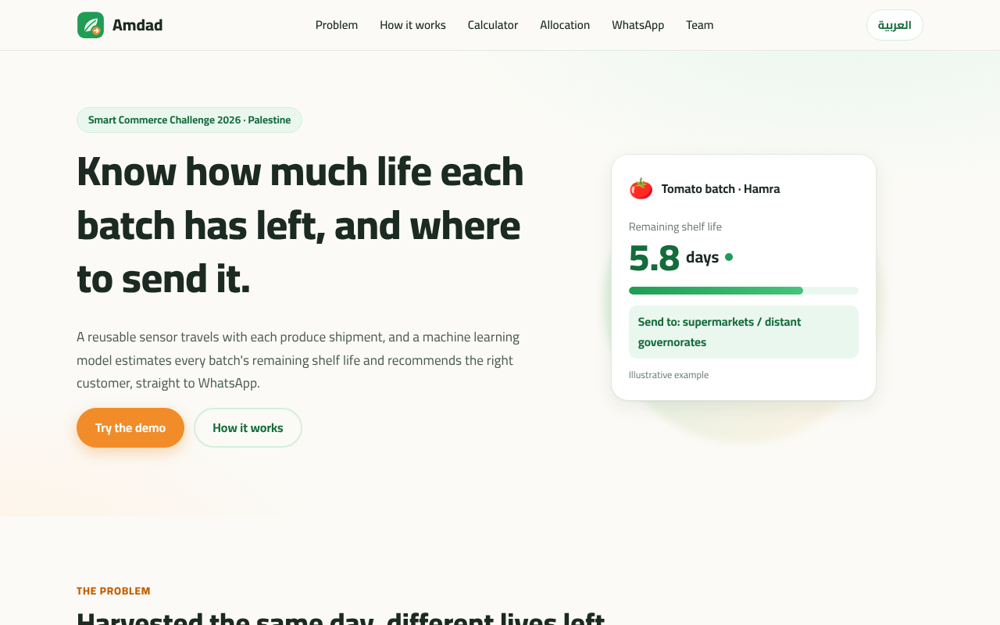
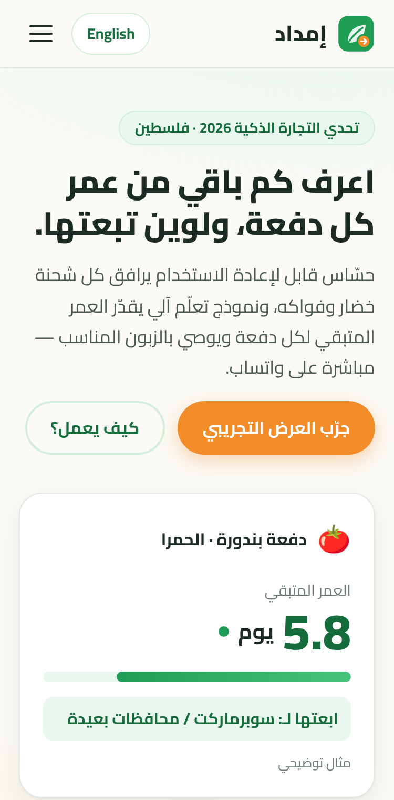

<p align="center">
  
</p>

<h1 align="center">Amdad · إمداد</h1>

<p align="center">
  <strong>Know how much life each batch has left, and where to send it.</strong><br>
  <span dir="rtl">اعرف كم باقي من عمر كل دفعة، ولوين تبعتها.</span>
</p>

<p align="center">
  <a href="https://rushdija.github.io/amdad/"></a>
  
  
</p>

<p align="center">
  <a href="https://rushdija.github.io/amdad/"><strong>🌐 Live demo</strong></a> ·
  <a href="README.ar.md">🇵🇸 اقرأ بالعربية</a> ·
  <a href="docs/model.md">📐 Model</a> ·
  <a href="docs/roadmap.md">🗺️ Roadmap</a>
</p>

---

Amdad is a startup in the **Smart Commerce Challenge 2026 (Palestine)**. This repository is the frontend-only MVP: a bilingual landing page with interactive demos of the shelf-life estimate, the batch allocation and the WhatsApp recommendation.

## The problem

Wholesale produce distributors in the West Bank move fruit and vegetables in **unrefrigerated trucks through checkpoints** such as Hamra and Tayasir. Heat and delays damage batches invisibly, so batches harvested the same day end up with **different remaining shelf life**. Distributors unknowingly send near-spoiled produce to customers who store it for days, and then **pay for the returns**.

- **MAS (2025):** 14 checkpoints on key routes, average delay 42 minutes.
- **PNN (2025):** a Hebron trader waited 1–4 hours at checkpoints; produce spoiled in closed trucks.
- **Wageningen University research:** 30–50% tomato losses in unrefrigerated trucks.

## The solution

A **reusable sensor travels with each shipment**, and a **specialized machine learning model** estimates each batch's remaining shelf life and **recommends the right customer**. Recommendations are delivered on **WhatsApp**, the tool distributors already use.

Inspired by Zest Fresh (USA), adapted to Palestine: checkpoints, unrefrigerated trucks and small distributors.

## How it works

1. 📡 **Sensor travels with the shipment**: logs temperature and time from harvest to delivery, including checkpoint waits.
2. 🧠 **ML model estimates remaining shelf life**: turns the trip log into days left for each batch.
3. 💬 **Recommendation on WhatsApp**: how much life the batch has left and where to send it (restaurant, grocery, supermarket).

## MVP features

- 🧮 **Batch shelf-life calculator**: product, quality, hours before loading, outside temperature, driving hours, checkpoint (with sample presets), sun/shade, truck type → remaining days, 🔴🟡🟢 category, recommended customer, SVG chart of shelf life consumed per stage, and a "what if it had waited in the shade" comparison.
- 📦 **FEFO batch allocation**: editable batches and customers; each batch goes to the customer with the longest storage need it can still satisfy, plus a summary of mismatches avoided.
- 💬 **Live WhatsApp preview**: a phone mock-up showing the message for the calculator batch, updated live.
- 🌍 **Bilingual**: Arabic (default, RTL) and English (LTR); the choice is remembered.
- 📱 **Mobile first**, accessible, no dependencies, works offline once loaded (except the web font).

## The model (summary)

A temperature–time model based on the **Q10 rule** (spoilage speeds up ~2–3× per +10 °C):

```
rate(T)        = Q10 ^ ((T − 20) / 10),   Q10 = 2.5
consumed_days  = hours × rate(T) / 24
remaining_days = base_shelf_life × quality_factor − Σ consumed_days
```

A "virtual sensor" estimates the truck's inside temperature from the outside temperature (e.g. +9 °C for a closed truck parked in the sun at a checkpoint). Example: tomato, good quality, 6 h before loading at 32 °C, 3 h driving, Hamra 2 h in the sun, closed truck → **5.8 days 🟢** (6.0 days if it had waited in the shade).

➡️ Full formulas, sample values and limitations: **[docs/model.md](docs/model.md)**

## Tech stack

- HTML5, CSS3 (logical properties for RTL/LTR), vanilla JavaScript (ES5-compatible)
- Plain SVG for the logo, icons and chart (no chart library)
- [Cairo](https://fonts.google.com/specimen/Cairo) from Google Fonts
- Hosted on GitHub Pages; no backend, no build step, no external APIs

## Run locally

Clone the repository and open `index.html` in your browser. That's it.

```bash
git clone https://github.com/RushdiJa/amdad.git
```

## Project structure

```
amdad/
├── index.html            # single-page site
├── css/style.css         # mobile-first styles, RTL/LTR
├── js/i18n.js            # all Arabic & English text + language switching
├── js/model.js           # Q10 shelf-life model + virtual sensor
├── js/allocation.js      # FEFO allocation + baseline comparison
├── js/app.js             # UI wiring, SVG chart, WhatsApp preview
├── assets/               # logo.svg, favicon.svg, og-image.png
├── docs/model.md         # model explanation, sample values, limitations
├── docs/roadmap.md       # MVP → pilot → ML model → WhatsApp bot
├── docs/screenshots/     # README screenshots
├── README.md / README.ar.md
├── CONTRIBUTING.md
└── LICENSE               # MIT
```

## Screenshots

| Desktop (English) | Mobile (Arabic) |
|---|---|
|  |  |
|  |  |

## Roadmap

1. **MVP** (this repo): landing page and interactive demos.
2. **Pilot** with 3–5 distributors and real sensors on Palestinian routes.
3. **Trained ML model** calibrated on pilot data, with photo-based quality checks.
4. **WhatsApp bot** delivering per-batch recommendations automatically.

Details: [docs/roadmap.md](docs/roadmap.md)

## Team

| Name | Role |
|---|---|
| Aram Odeh | Research |
| Eman Jallad | UI/UX Design |
| Rushdi Jallad | Field Testing |
| Melissa Odeh | Business & Marketing |
| Waseem Yahya | MVP Development |

## ⚠️ Disclaimer

Demo estimates use a **simplified scientific model with sample values**. They are not measurements and must not be used for real commercial decisions. The real product will be calibrated with sensor data from Palestinian trips.

## Contributing & license

See [CONTRIBUTING.md](CONTRIBUTING.md). Released under the [MIT License](LICENSE) © 2026 Amdad Team.

---

<p align="center"><a href="README.ar.md">اقرأ هذا الملف بالعربية ←</a></p>
